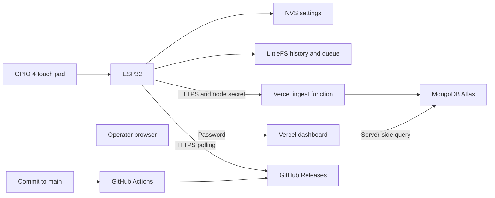
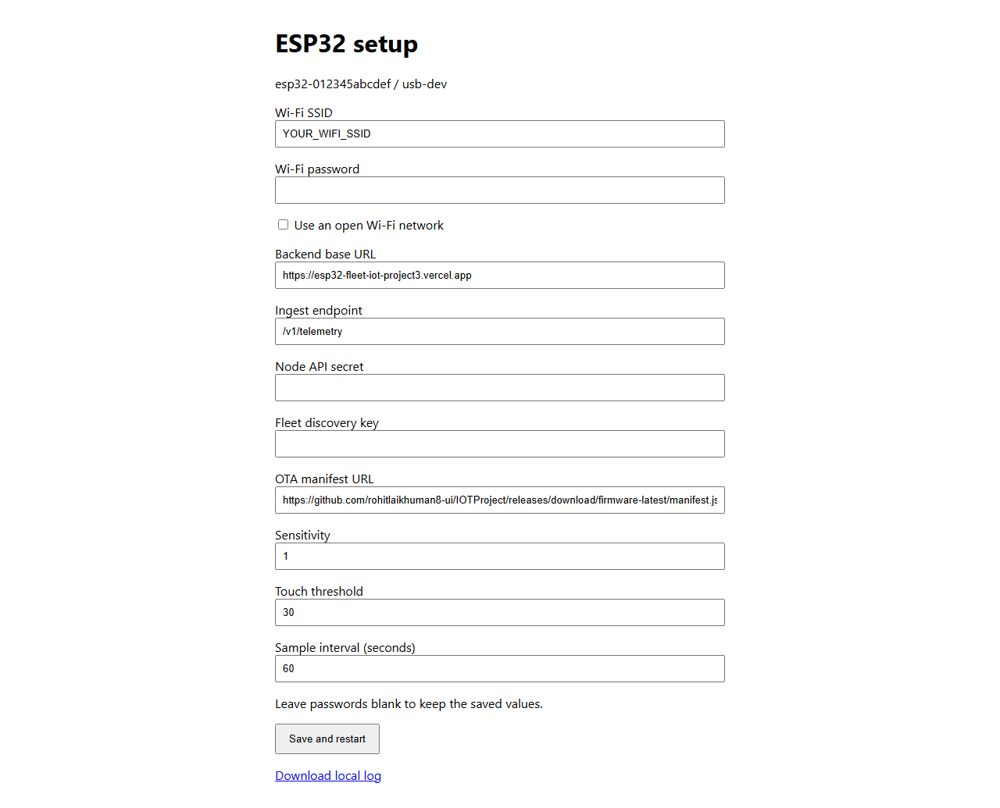

# IOTProject — ESP32 fleet telemetry

An ESP32 connects to Wi-Fi, records telemetry locally, uploads it over HTTPS, and receives firmware releases through OTA. A Next.js application on Vercel authenticates each node, writes samples to MongoDB Atlas, and provides a password-protected dashboard.

The hardware target is a **classic ESP32 DevKit with 4 MB flash** and an ADXL345 connected over I²C. X/Y/Z acceleration is reported in m/s², and the summary value is acceleration magnitude multiplied by sensitivity. GPIO 4 remains the capacitive setup input.

Four registered boards have been commissioned on release `408a075`, retaining separate identities and credentials. Online/Last-seen reflects each board's actual reporting. Captive-portal saving, 30 recent local records, and a complete 256-record download were verified on `esp32-7839a3f4e9d4`. See the [verification record](docs/VERIFICATION.md) for dated checkpoints and remaining hardware acceptance checks.

Node 1 (`esp32-d01de2f4e9d4`) has completed six-position measurement and a held-out offline bench screen. Its measured corrections were installed as `n1-20261125-v1`, read back after two reboots, and confirmed in tagged Atlas telemetry. Calibration-capable firmware preserves separate per-node coefficients in NVS; the dashboard shows each revision. See [the calibration record and operating commands](docs/CALIBRATION.md) for accuracy limits and remaining on-device checks.

Node 2 now runs **`n2-20261126-v2`**, saved and verified after reboot. It passed independent raw-data and on-device supported-pose numeric bench screens; the latter averaged 9.881484 m/s² (+0.763098%). The failed v1 trial is superseded and retained in history. Node 3 runs **`n3-20261126-v1`**, likewise saved/read back after reboot and independently checked offline and on-device; its final mean magnitude was **9.939455 m/s² (+1.354238%)**. Node 4 now runs **`n4-20261126-v1`**, saved/reboot-verified and passed independent offline and on-device checks, final mean **9.702494 m/s² (-1.062093%)**. All four nodes have their own installed correction and recorded numeric bench screen. Physical level was visually estimated, so these are limited bench results, not certified full orientation/temperature accuracy. A dashboard revision identifies applied settings, not production acceptance; see the complete calibration record. Controlled post-calibration movement/threshold, power-cut/rollback and endurance work remains.

The [November 26 post-calibration group check](docs/GROUP-CHECK-2026-11-26.md) verified all four reporting together with expected revisions, healthy sensor/storage/time flags and reciprocal three-peer discovery on channel 6. The [12:52 IST dashboard checkpoint](docs/images/dashboard-postcal-group-2026-11-26.png) shows **4 of 4 online**. The earlier [12:28 IST](docs/images/dashboard-calibration-four-revisions.png), [11:33 IST](docs/images/dashboard-calibration-three-nodes.png) and [10:49 IST](docs/images/dashboard-calibration-two-nodes.png) screenshots preserve previous stages. Next: an operator-confirmed quiet baseline and controlled movement checks, then fault/rollback testing.

## Connected node and wiring

| Item | Value |
| --- | --- |
| Last verified COM5 Node ID | `esp32-986aa3f4e9d4` (November 26 calibration installation/readback; verify identity whenever boards are swapped) |
| Latest calibrated node | Node 4 `esp32-3013a5f4e9d4`, **COM6**, November 26; `n4-20261126-v1` installed/reboot-verified and numeric bench checks passed |
| USB ports | COM5: Node 3; COM6: Node 4 at the latest identity checks. Always reverify identity after reconnection. |
| Chip | ESP32-D0WD-V3 revision 3.1 |
| ADXL345 SDA | GPIO 21 |
| ADXL345 SCL | GPIO 22 |
| ADXL345 VCC | 3V3 |
| ADXL345 GND | GND |
| Detected I²C address and identity | `0x53`, DEVID `0xE5` |
| Test Wi-Fi SSID | `Sensor Testing` |
| Commissioning sample interval | 10 seconds |
| Sensor mode | Full-resolution ±16 g, 100 Hz ODR |

| Node ID | Station MAC | Commissioning record |
| --- | --- | --- |
| `esp32-d01de2f4e9d4` | `d4:e9:f4:e2:1d:d0` | [Original board and November 23 return](docs/NODE-COM5.md) |
| `esp32-7839a3f4e9d4` | `d4:e9:f4:a3:39:78` | [November 23 board](docs/NODE-7839A3.md) |
| `esp32-986aa3f4e9d4` | `d4:e9:f4:a3:6a:98` | [Third board, November 23](docs/NODE-986AA3.md) |
| `esp32-3013a5f4e9d4` | `d4:e9:f4:a5:13:30` | [Fourth board, November 24](docs/NODE-3013A5.md) |

See the node records and [operating manual](docs/OPERATING_MANUAL.md) for USB upload commands, Arduino IDE export, settings, diagnostics, and sensor-calibration limits. Passwords and node secrets remain private. Each ESP32's SSID and password can be changed in its captive portal. Identify boards by Node ID/MAC; COM5 can be reused by different boards.

The live dashboard shows each node's direct cloud uplink and authenticated ESP-NOW neighbor sightings. Every node independently uploads through its configured Wi-Fi network. A dedicated task reports every five seconds while upload and OTA work run separately. The graph refreshes every three seconds and shows Online or Last seen in IST from accepted server reports. See [topology](docs/TOPOLOGY.md).

| Resource | Address |
| --- | --- |
| Dashboard | https://esp32-fleet-iot-project3.vercel.app/ |
| Ingest API | `POST https://esp32-fleet-iot-project3.vercel.app/v1/telemetry` |
| Repository | https://github.com/rohitlaikhuman8-ui/IOTProject |
| Configured node OTA manifest | [Vercel firmware manifest](https://esp32-fleet-iot-project3.vercel.app/v1/firmware) |
| Upstream release channel | [GitHub stable manifest](https://github.com/rohitlaikhuman8-ui/IOTProject/releases/download/firmware-latest/manifest.json) |
| Local setup panel | `http://192.168.4.1/` while connected to the device's setup AP |

## Guides

| Guide | Contents |
| --- | --- |
| [Complete operating manual](docs/OPERATING_MANUAL.md) | Adding/removing nodes, changing every setting, credentials, recovery, troubleshooting, safety and maintenance |
| [Hardware and first flash](docs/HARDWARE.md) | Board, wiring, tool installation, USB flashing, touch calibration |
| [COM5 node record](docs/NODE-COM5.md) | Actual chip, Node ID, ADXL345 wiring, upload, private provisioning |
| [November 23 node](docs/NODE-7839A3.md) | Board identity, backup, independent registration and commissioning |
| [Third node](docs/NODE-986AA3.md) | Separate credential, first-time storage, November 23 checks |
| [Fourth node](docs/NODE-3013A5.md) | November 24 commissioning, segmented USB recovery and movement test |
| [Live topology](docs/TOPOLOGY.md) | Independent cloud uplinks, heartbeats, authenticated radio neighbors |
| [Four-node group check](docs/GROUP-CHECK-2026-11-25.md) | November 25 simultaneous reporting, mutual radio sightings and remaining checks |
| [Sensor calibration](docs/CALIBRATION.md) | Sequential node order, reference positions, measurements and application limits |
| [Deployment](docs/DEPLOYMENT.md) | Atlas, Vercel, environment variables, local development |
| [Operating procedures](docs/OPERATIONS.md) | Commissioning, provisioning, dashboard, exports, credential rotation |
| [Firmware and OTA](docs/FIRMWARE.md) | Scheduling, persistence, watchdog, brownout, releases, rollback |
| [API reference](docs/API.md) | Authentication, payloads, errors, PowerShell upload |
| [Troubleshooting](docs/TROUBLESHOOTING.md) | Portal, Wi-Fi, uploads, storage, deployment, OTA |
| [Architecture and limits](docs/ARCHITECTURE.md) | Data flow, security boundaries, retention, implementation limits |
| [Verification record](docs/VERIFICATION.md) | Recorded checks and outstanding bench checks |
| [Project tools](docs/TOOLS.md) | Serial helper, Arduino export, screenshot capture and source layout |
| [Screenshots](docs/images/README.md) | Image sources and regeneration commands |

## Architecture



The dashboard and ingest API share the `dashboard/` Next.js application. This deployment uses Vercel Functions for ingestion. Each device holds an individual API secret, and MongoDB credentials stay in server environment variables.

## Quick start

Commands use PowerShell from the repository root unless a command changes directories. Install Git, Python 3.12, and Node.js 22 with npm.

```powershell
git clone https://github.com/rohitlaikhuman8-ui/IOTProject.git
Set-Location IOTProject
py -3.12 -m venv .venv
.\.venv\Scripts\python.exe -m pip install platformio==6.1.18
.\.venv\Scripts\python.exe -m platformio run -d firmware
.\.venv\Scripts\python.exe -m platformio device list
```

Select the actual ESP32 serial port. On a **new device**, flash the application and initialize the filesystem.

```powershell
.\.venv\Scripts\python.exe -m platformio run -d firmware -t upload --upload-port COM5
.\.venv\Scripts\python.exe -m platformio run -d firmware -t uploadfs --upload-port COM5
.\.venv\Scripts\python.exe -m platformio device monitor --port COM5 --baud 115200
```

The `uploadfs` target replaces the filesystem and clears existing local logs. Use it for initial installation or intentional filesystem recovery after exporting logs. Routine updates use the application upload or OTA.

1. Record the `esp32-<12 lowercase hex characters>` Node ID printed on serial.
2. Generate a unique node secret and add it under that ID in Vercel's `NODE_SECRETS_JSON`. Redeploy the application to apply the change.
3. Join the device setup Wi-Fi using its saved private AP password, printed on serial when setup opens.
4. Visit `http://192.168.4.1/`, enter Wi-Fi credentials and the settings below, and save.
5. Reconnect your computer to its normal network and sign in to the dashboard.

| Portal setting | Initial value |
| --- | --- |
| Backend base URL | `https://esp32-fleet-iot-project3.vercel.app` |
| Ingest endpoint | `/v1/telemetry` |
| Node API secret | The secret registered for this Node ID |
| OTA manifest URL | `https://github.com/rohitlaikhuman8-ui/IOTProject/releases/download/firmware-latest/manifest.json` |
| Sensitivity | `1` |
| Touch threshold | `30`, then calibrate for your board |
| Sample interval | `60` seconds |

Hold the GPIO 4 capacitive pad continuously for four seconds to reopen setup. The AP expires after 15 minutes. The hardware-derived Node ID appears as a read-only value.

## Normal startup, time and movement

After power-on, local logging starts automatically. Once the saved Wi-Fi network provides internet access, the node attempts cloud delivery and reports its connection. It synchronizes time on every boot using SNTP and the verified server's HTTP Date. Local time and dashboard displays use IST. Atlas retains server-generated UTC instants so timezone conversion is applied once.

The dashboard records startup, connection/resumption, report timeouts and movement notifications. Movement rows are highlighted and use authoritative server receipt time, with device capture time retained separately when available. The ADXL345 is polled about every 20 ms, with a configurable vector-change threshold and a two-second notification cooldown.

The GPIO 2 status LED shows solid for recent cloud contact, slow blink for Wi-Fi reconnection, a double flash for Wi-Fi without recent cloud contact, fast blink for setup, and triple flash for sensor/storage trouble.

## Captive portal procedure

1. Hold the GPIO 4 touch pad for four seconds, or send `portal` through USB Serial Monitor at 115200 baud with newline endings.
2. Join `ESP32-Setup-7839a3f4e9d4` for the current board using its private saved AP password. The complete hardware-derived ID makes setup network names unique.
3. Open `http://192.168.4.1/` if the captive popup does not appear.
4. Change SSID, Wi-Fi password, setup AP password, endpoint, secrets, thresholds or sample interval as needed. Blank password/secret fields preserve the saved values as described in the manual.
5. Review current IST time, connection state, pending records and recent local logs. Download the retained NDJSON log before destructive recovery.
6. Save and wait for restart, then check Online and a fresh IST timestamp in the dashboard.

The node keeps its station connection active during setup when that network is available. If saved Wi-Fi remains unavailable after about 30 seconds, a recovery AP opens while reconnection attempts continue. The [complete manual](docs/OPERATING_MANUAL.md) covers password changes, forgotten credentials, node registration/removal and failure recovery.

## Screenshots

### Dashboard sign-in

The dashboard uses `DASHBOARD_PASSWORD` from Vercel's server environment. The existing operator has a Git-ignored local copy in `dashboard/.env.local`.


### Fleet dashboard

Topology, health, notification history and the latest 100 telemetry events refresh automatically. Click a Node ID to filter history. All displayed timestamps use IST, and server receipt time is authoritative.


### Device setup panel

This reference screenshot renders the **actual firmware portal HTML using sample settings**. It was captured without a connected ESP32. Wi-Fi passwords and API secrets are omitted.



## Local dashboard

```powershell
Set-Location dashboard
Copy-Item .env.example .env.local
# Edit .env.local with development credentials.
npm install
npm run dev
```

Open `http://localhost:3000/`. Required server variables are `MONGODB_URI`, `MONGODB_DATABASE`, `NODE_SECRETS_JSON`, and `DASHBOARD_PASSWORD`. See [deployment](docs/DEPLOYMENT.md).

## Development and releases

The initial main-branch push is authorized for this handoff. For subsequent firmware changes, create a branch and open a pull request.

```powershell
git switch -c feature/sensor-driver
# Implement the sensor and build the firmware.
git add firmware
git commit -m "Add sensor measurement driver"
git push -u origin feature/sensor-driver
```

After merge to `main`, GitHub Actions publishes a commit-specific binary and switches the stable manifest. Nodes poll at startup and approximately every 15 minutes when connected. Offline nodes apply a release after reconnecting and completing a successful check. Detailed [OTA procedures](docs/FIRMWARE.md) include failure handling and rollback.

## Directory map

```text
IOTProject/
├── .github/workflows/
│   ├── firmware-ci.yml           # Compile firmware for pull requests
│   └── firmware-release.yml      # Publish fleet OTA on main
├── firmware/
│   ├── platformio.ini            # Pinned classic ESP32 build settings
│   ├── src/main.cpp              # Provisioning, sampling, storage, retry, OTA
│   └── data/.gitkeep              # Initial LittleFS directory
├── dashboard/
│   ├── app/page.tsx              # Dashboard and password sessions
│   ├── app/layout.tsx            # HTML layout
│   ├── app/v1/telemetry/route.ts  # Authenticated, deduplicated ingestion
│   ├── lib/fleet.ts              # Schema, MongoDB client, secret comparison
│   ├── .env.example              # Placeholder configuration
│   └── package.json              # Next.js application dependencies
├── docs/                         # Procedures and screenshots
├── scripts/capture-docs.cjs       # Reproduce documentation screenshots
└── README.md
```

## Persistence and limits

- NVS stores settings as one configuration record.
- LittleFS holds up to 256 committed samples, including pending and acknowledged records. At 60-second sampling, that covers roughly 4 hours 16 minutes. Pending records take priority over acknowledged history.
- An all-pending log skips new samples until acknowledged records can be reclaimed.
- Upload retries grow from five seconds to five minutes with jitter. A stable event ID lets Atlas deduplicate delivery retries.
- Brownout detection and a 45-second task watchdog provide reset recovery. Power loss can interrupt an uncommitted measurement. Bench validation remains necessary.
- Telemetry contains ADXL345 X/Y/Z, magnitude and movement events. Topology, current sensor data and notification history refresh automatically in IST.
- OTA verifies HTTPS, board type, length, and SHA-256. Independent image signing and Secure Boot need a separate manufacturing setup.

OTA can follow GitHub directly or use the Vercel manifest at `https://esp32-fleet-iot-project3.vercel.app/v1/firmware` when a network cannot reach GitHub release hosts. Both follow the same Actions-published channel. The Vercel route serves only this repository's validated images; the ESP32 checks them again. See [OTA operations](docs/FIRMWARE.md) and the [measured verification record](docs/VERIFICATION.md) for successful updates, failures and recovery procedures.

The ADXL345 firmware has been built and flashed on all four commissioned boards. Sensor identity, live reads, Wi-Fi, and persistent local storage were exercised. The November 25 basic group check verified simultaneous cloud reporting and mutual radio discovery. Calibration, independent-network/separation tests, controlled power cuts, and failed-image rollback still need targeted bench checks. See the [verification record](docs/VERIFICATION.md).

On November 23, 2026, node `esp32-7839a3f4e9d4` installed release `408a075` remotely through Vercel, verified and rebooted successfully, retained 256 records, and resumed reporting with zero backlog. The 1,224,352-byte binary transfer took 41 seconds. Its Wi-Fi and OTA settings remained saved; setup AP was inactive. The dashboard confirmed the new version, online status, IST telemetry and movement notifications.

Later that evening, `esp32-d01de2f4e9d4` returned on COM5 and received the same checksum-verified release over USB. All 256 existing records migrated without formatting and passed a read-only integrity check with zero invalid records. Its original Node ID/secret were retained, and its saved Vercel OTA channel was checked successfully. The operator's tilt produced five verified cloud movement notifications. Its historical backlog finished uploading, reaching zero pending records by 21:45:30 IST.

Third node `esp32-986aa3f4e9d4` passed provisioning, reboot persistence, sensor/storage, movement and current-version OTA checks on November 23. Fourth node `esp32-3013a5f4e9d4` passed the same commissioning checks on November 24 after recovery from two interrupted USB writes. Both received unique secrets, with earlier registrations preserved. Their checkpoints showed zero pending uploads; this is not a guarantee that an unplugged node's last report is a live reading or always has an empty queue.

Later on November 24 the third board was reconnected to COM5. It already had the current firmware, restored its saved settings, resumed authenticated uploads and passed a read-only check of all 83 then-retained records with zero errors. No reflash, formatting, credential change or fifth registration was needed. See its [reconnect record](docs/NODE-986AA3.md#november-24-reconnect-check).
