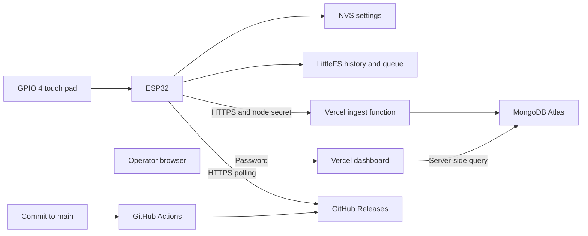
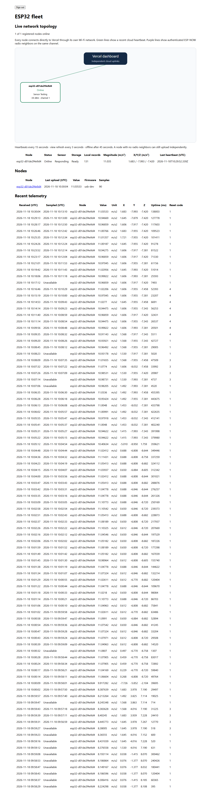

# IOTProject — ESP32 fleet telemetry

An ESP32 connects to Wi-Fi, records telemetry locally, uploads it over HTTPS, and receives firmware releases through OTA. A Next.js application on Vercel authenticates each node, writes samples to MongoDB Atlas, and provides a password-protected dashboard.

The hardware target is a **classic ESP32 DevKit with 4 MB flash**. The current sample measures capacitive touch on GPIO 4 and multiplies the reading by sensitivity. Replace that expression with the actual sensor driver when the sensor is selected.

| Resource | Address |
| --- | --- |
| Dashboard | https://esp32-fleet-iot-project3.vercel.app/ |
| Ingest API | `POST https://esp32-fleet-iot-project3.vercel.app/v1/telemetry` |
| Repository | https://github.com/rohitlaikhuman8-ui/IOTProject |
| OTA manifest | https://github.com/rohitlaikhuman8-ui/IOTProject/releases/download/firmware-latest/manifest.json |
| Local setup panel | `http://192.168.4.1/` while connected to the device's setup AP |

## Guides

| Guide | Contents |
| --- | --- |
| [Hardware and first flash](docs/HARDWARE.md) | Board, wiring, tool installation, USB flashing, touch calibration |
| [Deployment](docs/DEPLOYMENT.md) | Atlas, Vercel, environment variables, local development |
| [Operating procedures](docs/OPERATIONS.md) | Commissioning, provisioning, dashboard, exports, credential rotation |
| [Firmware and OTA](docs/FIRMWARE.md) | Scheduling, persistence, watchdog, brownout, releases, rollback |
| [API reference](docs/API.md) | Authentication, payloads, errors, PowerShell upload |
| [Troubleshooting](docs/TROUBLESHOOTING.md) | Portal, Wi-Fi, uploads, storage, deployment, OTA |
| [Architecture and limits](docs/ARCHITECTURE.md) | Data flow, security boundaries, retention, implementation limits |
| [Verification record](docs/VERIFICATION.md) | Recorded checks and outstanding bench checks |
| [Screenshots](docs/images/README.md) | Image sources and regeneration commands |

## Architecture



The dashboard and ingest API share the `dashboard/` Next.js application. This deployment uses Vercel Functions for ingestion. Each device holds an individual API secret, and MongoDB credentials stay in server environment variables.

## Quick start

Commands use PowerShell from the repository root unless a command changes directories. Install Git, Python 3.12, and Node.js 22 with npm.

```powershell
git clone https://github.com/rohitlaikhuman8-ui/IOTProject.git
Set-Location IOTProject
py -3.12 -m venv .venv
.\.venv\Scripts\python.exe -m pip install platformio==6.1.18
.\.venv\Scripts\python.exe -m platformio run -d firmware
.\.venv\Scripts\python.exe -m platformio device list
```

Select the actual ESP32 serial port. On a **new device**, flash the application and initialize the filesystem.

```powershell
.\.venv\Scripts\python.exe -m platformio run -d firmware -t upload --upload-port COM5
.\.venv\Scripts\python.exe -m platformio run -d firmware -t uploadfs --upload-port COM5
.\.venv\Scripts\python.exe -m platformio device monitor --port COM5 --baud 115200
```

The `uploadfs` target replaces the filesystem and clears existing local logs. Use it for initial installation or intentional filesystem recovery after exporting logs. Routine updates use the application upload or OTA.

1. Record the `esp32-<12 lowercase hex characters>` Node ID printed on serial.
2. Generate a unique node secret and add it under that ID in Vercel's `NODE_SECRETS_JSON`. Redeploy the application to apply the change.
3. Join the device setup Wi-Fi using the temporary password printed on serial.
4. Visit `http://192.168.4.1/`, enter Wi-Fi credentials and the settings below, and save.
5. Reconnect your computer to its normal network and sign in to the dashboard.

| Portal setting | Initial value |
| --- | --- |
| Backend base URL | `https://esp32-fleet-iot-project3.vercel.app` |
| Ingest endpoint | `/v1/telemetry` |
| Node API secret | The secret registered for this Node ID |
| OTA manifest URL | `https://github.com/rohitlaikhuman8-ui/IOTProject/releases/download/firmware-latest/manifest.json` |
| Sensitivity | `1` |
| Touch threshold | `30`, then calibrate for your board |
| Sample interval | `60` seconds |

Hold the GPIO 4 capacitive pad continuously for four seconds to reopen setup. The AP expires after 15 minutes. The hardware-derived Node ID appears as a read-only value.

## Screenshots

### Dashboard sign-in

The dashboard uses `DASHBOARD_PASSWORD` from Vercel's server environment. The existing operator has a Git-ignored local copy in `dashboard/.env.local`.


### Fleet dashboard

The signed-in view lists nodes, firmware versions, last uploads, sample counts, and the latest 100 events. Click a Node ID to filter the events. Reload the page to fetch current data. Displayed times use UTC.



### Device setup panel

This reference screenshot renders the **actual firmware portal HTML using sample settings**. It was captured without a connected ESP32. Wi-Fi passwords and API secrets are omitted.


## Local dashboard

```powershell
Set-Location dashboard
Copy-Item .env.example .env.local
# Edit .env.local with development credentials.
npm install
npm run dev
```

Open `http://localhost:3000/`. Required server variables are `MONGODB_URI`, `MONGODB_DATABASE`, `NODE_SECRETS_JSON`, and `DASHBOARD_PASSWORD`. See [deployment](docs/DEPLOYMENT.md).

## Development and releases

The initial main-branch push is authorized for this handoff. For subsequent firmware changes, create a branch and open a pull request.

```powershell
git switch -c feature/sensor-driver
# Implement the sensor and build the firmware.
git add firmware
git commit -m "Add sensor measurement driver"
git push -u origin feature/sensor-driver
```

After merge to `main`, GitHub Actions publishes a commit-specific binary and switches the stable manifest. Nodes poll at startup and approximately every 15 minutes when connected. Offline nodes apply a release after reconnecting and completing a successful check. Detailed [OTA procedures](docs/FIRMWARE.md) include failure handling and rollback.

## Directory map

```text
IOTProject/
├── .github/workflows/
│   ├── firmware-ci.yml           # Compile firmware for pull requests
│   └── firmware-release.yml      # Publish fleet OTA on main
├── firmware/
│   ├── platformio.ini            # Pinned classic ESP32 build settings
│   ├── src/main.cpp              # Provisioning, sampling, storage, retry, OTA
│   └── data/README.txt            # Initial LittleFS content
├── dashboard/
│   ├── app/page.tsx              # Dashboard and password sessions
│   ├── app/layout.tsx            # HTML layout
│   ├── app/v1/telemetry/route.ts  # Authenticated, deduplicated ingestion
│   ├── lib/fleet.ts              # Schema, MongoDB client, secret comparison
│   ├── .env.example              # Placeholder configuration
│   └── package.json              # Next.js application dependencies
├── docs/                         # Procedures and screenshots
├── scripts/capture-docs.cjs       # Reproduce documentation screenshots
└── README.md
```

## Persistence and limits

- NVS stores settings as one configuration record.
- LittleFS holds up to 256 committed samples, including pending and acknowledged records. At 60-second sampling, that covers roughly 4 hours 16 minutes. Pending records take priority over acknowledged history.
- An all-pending log skips new samples until acknowledged records can be reclaimed.
- Upload retries grow from five seconds to five minutes with jitter. A stable event ID lets Atlas deduplicate delivery retries.
- Brownout detection and a 45-second task watchdog provide reset recovery. Power loss can interrupt an uncommitted measurement. Bench validation remains necessary.
- The current telemetry value is a touch reading. The dashboard presents tables and refreshes on navigation or reload.
- OTA verifies HTTPS, board type, length, and SHA-256. Independent image signing and Secure Boot need a separate manufacturing setup.

The classic ESP32 firmware compiled locally on November 13, 2026 and in GitHub Actions on November 18. The first OTA release is published, and the Vercel application deployed successfully. Hardware commissioning, sensor integration, touch calibration, power-cut behavior, and OTA rollback still require bench checks. See the [verification record](docs/VERIFICATION.md).
