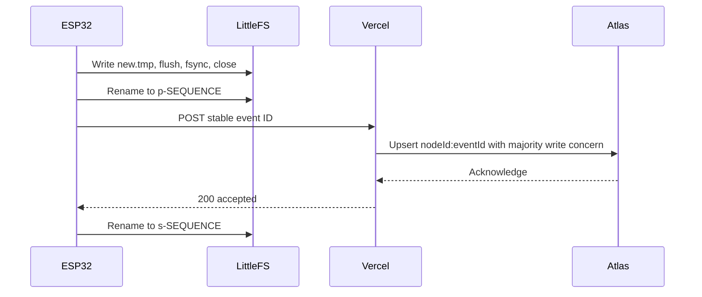

# Architecture and limits

## Scheduling

The main loop handles sensor, touch, local logging and the portal. Separate heartbeat and upload/OTA tasks isolate status reporting from slow transfers. Wi-Fi reconnect attempts start every 30 seconds. Setup uses a one-client AP alongside station Wi-Fi.

Periodic sampling defaults to 60 seconds and accepts 10 through 86,400 seconds. Motion is polled about every 20 ms with a configurable threshold and two-second cooldown. Flash operations can still delay acquisition. Strict sampling guarantees require a dedicated acquisition design.

SNTP starts after Wi-Fi connects. Cloud reporting can start immediately and synchronize time from the verified server Date header. IST is configured on every boot. A pending OTA image checks storage, sensor, network, time and successful cloud reporting.

## Identity and authentication

The Node ID is `esp32-` followed by the 12-digit hexadecimal value of `ESP.getEfuseMac()`. It survives firmware and settings changes. Copy it exactly, including lowercase hex digits.

The API looks up that ID in `NODE_SECRETS_JSON`. It hashes secrets and compares fixed-size digests using a timing-safe comparison.

Dashboard sign-in creates an HMAC-signed, HttpOnly, SameSite Strict cookie with an eight-hour expiry. Production cookies are Secure. Changing the password changes the signing key.

## Durable delivery

If the database write succeeds but the ESP32 loses power before local acknowledgment, the retry uses the same event ID. Atlas's unique `_id` and `$setOnInsert` preserve the original record and receive time.

The scanner ignores incomplete `new.tmp` files and resumes sequence numbers after the highest committed filename. An unmountable filesystem is not automatically formatted. Initial filesystem provisioning is explicit.

The export includes both pending `p-...` files and acknowledged `s-...` files. Scan order is unspecified. Sort exported samples during analysis.

## Retention

The log holds at most 256 records. Filesystem metadata and free blocks can still cause earlier write failure. The default partition table provides two OTA application slots and a local filesystem.

At the limit, the oldest acknowledged file is deleted before the next sample is written. If that replacement fails, history can shrink. If every slot is pending, the new sample is skipped. Changing the retention constant requires checking actual free space.

NVS and LittleFS reduce exposure to interrupted writes. An in-progress sample can still be lost. Brownout resets cannot compensate for a faulty supply or unlimited offline duration.

## API and dashboard

The API checks Content-Length, validates one record, authenticates the node, and upserts it. The MongoDB client is reused within a warm function instance with a pool size of five.

The dashboard polls status, the latest 100 telemetry events and the latest 100 notifications. History can be filtered by node. Server timestamps are stored as UTC instants and displayed in IST.

## Current boundaries

| Area | Behavior |
| --- | --- |
| Portal access | Saved random per-node AP password on serial, one client, 15-minute lifetime |
| Portal requests | HTTP on the setup AP, settings form uses a random token |
| At-rest device secrets | NVS with no enabled flash encryption |
| Upload and OTA transport | Certificate-verified HTTPS |
| OTA integrity | Board, size, SHA-256, trusted HTTPS manifest |
| Firmware signing | Independent image signing and Secure Boot are not configured |
| Dashboard authentication | Shared operator password, no application rate limiter |
| Database network | Owner-approved all-IPv4 access for dynamic egress, database authentication required |
| Fleet settings | Configured locally per node |
| Sensor value | ADXL345 X/Y/Z in m/s² and scaled magnitude |
| Deep sleep | No sleep schedule implemented |
| Hardware support | Classic ESP32, other families need adaptation |

See [operations](OPERATIONS.md) and [troubleshooting](TROUBLESHOOTING.md) for procedures.

## Live presence and radio discovery

Heartbeats update Atlas every five seconds. The dashboard polls every three seconds and uses a 90-second presence window. Direct uplinks operate independently of radio neighbors. Startup, connection, movement and observed timeout events persist in `notifications`. See [topology](TOPOLOGY.md).
