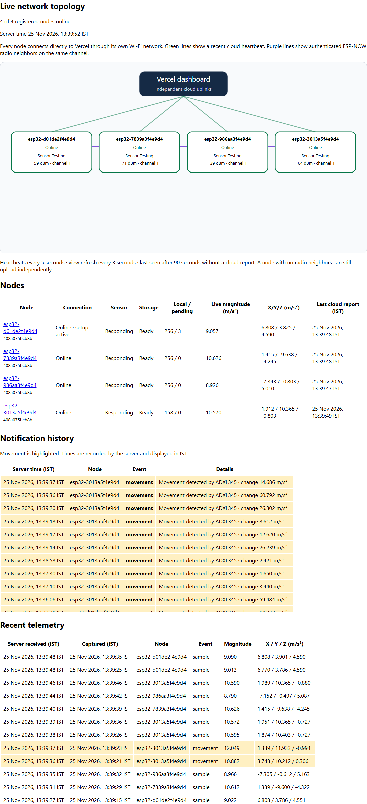

# Basic four-node group check — November 25, 2026

## Scope and result

The operator powered all four commissioned boards together. This check follows the live path from independent ESP32 HTTPS reporting to Atlas records, the authenticated Vercel topology API and the rendered dashboard. All four reported healthy sensors/storage, synchronized clocks, firmware `408a075bcb8b8eb4366a380ffc283637349bcc57`, and Wi-Fi channel 1 on Sensor Testing. Each reported the other three as radio neighbors: all six mutual pairs were observed.

This checks basic simultaneous connectivity and discovery. Radio neighbor edges represent ESP-NOW discovery; telemetry goes directly from each node to Vercel. There is no multi-hop forwarding.

## Observation results

The completed window ran **13:37:47.949–13:39:52.474 IST**, with nine authenticated snapshots about 15 seconds apart (124.525 seconds total). An earlier four-snapshot window at 13:35:40–13:36:27 also showed all four reporting. The table below uses the completed window.

| Node ID | Oldest accepted report at a snapshot | RSSI range (dBm) | Pending range / final | Local records, start → end | Distinct latest event IDs observed |
| --- | --- | --- | --- | --- | --- |
| `esp32-d01de2f4e9d4` | 9.069 s | -64 to -56 | 0–3 / 3 | 256 → 256 | 9 |
| `esp32-7839a3f4e9d4` | 5.196 s | -71 to -64 | 0–1 / 0 | 256 → 256 | 9 |
| `esp32-986aa3f4e9d4` | 4.798 s | -39 to -34 | 0 / 0 | 256 → 256 | 9 |
| `esp32-3013a5f4e9d4` | 4.777 s | -64 to -55 | 0–4 / 0 | 138 → 158 | 8 |

All four were online in every snapshot, well inside the 90-second presence timeout. Sensor/storage/time flags stayed healthy. Each retained the same boot ID with nondecreasing reported uptime, providing no evidence of a reboot during this window. New latest measurement IDs and server receipt times advanced for every node. The distinct-ID count above counts sampled snapshots, not all uploaded events.

All six pairs were mutual in six of the nine snapshots. Other snapshots showed five mutual plus one one-sided pair, or four mutual plus two one-sided pairs. The final snapshot had five mutual pairs; `7839a3` did not list `d01de2`, while `d01de2` listed `7839a3`. Neither cloud uplink went offline. This establishes working group discovery, not continuously reliable reception on every radio link.

Queues repeatedly reached zero. The original node ended with three pending readings; those were not deleted or declared delivered. The fourth node's temporary four-reading queue returned to zero by the final snapshot. The rolling 256-record limit explains why older nodes' retained counts stay constant while fresh events continue arriving. No new filesystem integrity scan was performed during group acquisition; storage health here is the device-reported availability flag.

## Independent database evidence

A read-only Atlas query found all four sampled event IDs in `esp32_fleet.events`, with the matching Node ID and server receipt time. A separate read of `nodes` confirmed current reports and neighbor lists for all four registrations. These are actual stored records, not example data.

| Node ID | Example stored event ID | Server receipt, November 25 IST |
| --- | --- | --- |
| `esp32-d01de2f4e9d4` | `5d25b4c4da3362dcecaad1c167cc1e3f` | 13:35:36.723 |
| `esp32-7839a3f4e9d4` | `b9d93ca13f9348fb99a64df41a8a2f4a` | 13:35:33.536 |
| `esp32-986aa3f4e9d4` | `a6ed63c492b22feb9560f431ebfb2613` | 13:35:34.945 |
| `esp32-3013a5f4e9d4` | `03488919a5f597b6d72f5cc2cfe39f44` | 13:35:37.259 |

Server receipt time is authoritative. Atlas stores UTC; this document and dashboard display IST (UTC+05:30).

## Dashboard evidence

[Full authenticated dashboard capture](images/dashboard-group-check.png). Screenshots contain live reports and no credentials.

The rendered dashboard showed **4 of 4 registered nodes online**, live readings, IST server time, sensor/storage status and highlighted movement history. The current graph places the nodes in one horizontal row, so several radio edges overlap visually. Exact pair status was verified from API neighbor lists; improving edge separation remains a dashboard presentation follow-up. Movement notifications seen during this check are not a controlled one-node-at-a-time attribution test.

The first browser observation stopped after four snapshots because the laptop's HTTP transport received `ECONNRESET`. The observer was adjusted to handle an aborted browser fetch and retry connection resets, then the live check was repeated. This is a recorded test-client transport failure; it does not establish an ESP32 reboot or outage. No firmware or production application change was needed.

The original node reported `setup` mode while continuing to send measurements and heartbeats. The current firmware keeps station Wi-Fi active during its temporary setup AP. Its AP expires after 15 minutes; it can open after a four-second capacitive hold or prolonged Wi-Fi loss. The cloud report alone cannot identify which trigger opened this session. No settings were re-entered and the portal was not deliberately opened for this check.

## Repeat the basic group check

1. Power each board from a stable supply with its sensor wiring intact. Keep exposed pins clear of conductive surfaces. Initially place boards within radio range of one another. Do not hold the GPIO 4 capacitive pad.
2. Keep the saved Wi-Fi network available. Saved NVS settings are reused automatically; do not reopen provisioning just to reconnect.
3. Sign in to the [production dashboard](https://esp32-fleet-iot-project3.vercel.app/) and confirm the four full Node IDs against the [inventory](../README.md). Do not identify boards by COM-port number.
4. Observe at least two minutes of reports. Check all four stay online, measurement times advance, sensor/storage/time health remain good, and pending queues clear rather than grow continuously. A count of one or two pending readings can be normal while sampling and uploading overlap.
5. Check the Wi-Fi channel reported by each node. With a common discovery key and shared channel, each nearby node should list its peers. Solid purple graph edges mean reciprocal sightings; dashed edges mean one-sided sightings. Both endpoints can remain cloud-online even when they cannot hear each other.
6. Review fresh server-stamped event history for each Node ID. A green dot proves recent accepted reporting; check measurement progress separately.
7. Record start/end times, firmware, channels, freshness, queue behavior and exceptions. Capture the graph without exposing passwords or cookies. Update this documentation for any subsequent configuration or firmware change.

For a missing cloud report, first check the node's supply, saved network internet access, unique API credential and backend URL. For missing radio edges with healthy cloud reporting, check common channel, shared discovery key, distance and interference. See the [operating manual](OPERATING_MANUAL.md) and [topology guide](TOPOLOGY.md) for full procedures. A temporary laptop/dashboard fetch failure must be distinguished from a node's expired last-seen timestamp.

## Remaining acceptance, in order

1. Calibrate each ADXL345 in its intended mounting position and tune movement thresholds against a still baseline and known movement.
2. Verify movement attribution with one node moved at a time while the others stay still.
3. Test RF separation and independent internet networks, including different radio channels; cloud uploads should remain independent even when neighbor edges disappear. Exercise network loss and recovery deliberately.
4. Test controlled power interruption, local-log recovery and interrupted/failed OTA rollback on one bench node first, then verify the required recovery checks on each board. Back up retained logs/settings before fault tests. Do not disconnect wiring while powered.
5. After calibration and any fixes, run a sustained group endurance check, including a 24-hour observation and backlog review.

This short group check does not certify calibration, flash integrity under power interruption, rollback, RF coverage, or production endurance. Earlier per-node movement and storage checks remain in their individual commissioning records.
