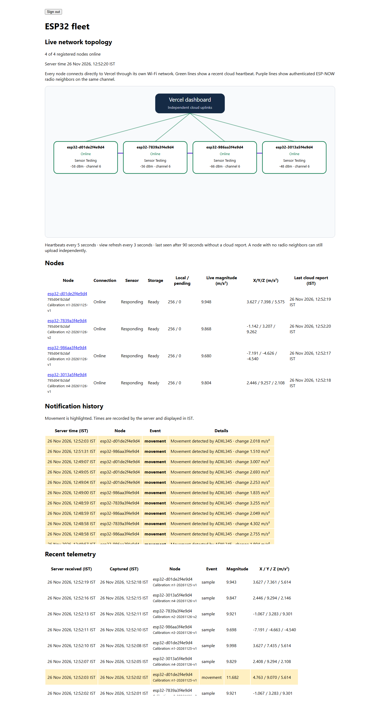

# Post-calibration four-node group check — November 26, 2026

## Result and scope

All four registered nodes resumed reporting with their own saved calibration revisions on firmware `795d041b2daf1b4d9e1448890c7ef16c3de0c8f7`. A short simultaneous reporting and radio-neighbor observation passed. No device settings, firmware, credentials or calibration coefficients were changed during this check.

The declared device-capture window was **12:49:05–12:51:05 IST** (07:19:05–07:21:05 UTC). Six separate Atlas node-state snapshots, taken approximately 25 seconds apart plus query time, extended beyond that capture window. [Machine-readable evidence](calibration/postcal-group-check-2026-11-26.json) preserves each snapshot and all 49 periodic events selected by device capture time. Capture timestamps and server receipt timestamps remain separate.

| Node | Saved revision | Periodic samples / span | Observed pending range / final snapshot | Radio peers |
| --- | --- | --- | --- | --- |
| `esp32-d01de2f4e9d4` | `n1-20261125-v1` | 12 / 110 s | 0 / 0 | Other three in every snapshot |
| `esp32-7839a3f4e9d4` | `n2-20261126-v2` | 12 / 110 s | 0–1 / 0 | Other three in every snapshot |
| `esp32-986aa3f4e9d4` | `n3-20261126-v1` | 12 / 110 s | 0–1 / 1 | Other three in every snapshot |
| `esp32-3013a5f4e9d4` | `n4-20261126-v1` | 13 / 120 s | 0–1 / 0 | Other three in every snapshot |

All four retained stable boot IDs within the observation and consistently reported healthy sensors/storage, synchronized time, running mode, 256 retained local records and Wi-Fi channel 6. Reports remained inside the 90-second online timeout. Every selected event had the expected Node ID, firmware and per-node revision, and event IDs were unique for each node. Each node's queue reached zero at least once; Node 3's final Atlas snapshot still had one pending record, which is not claimed delivered by that snapshot. The later dashboard capture showed zero pending for all four.

All six node pairs had reciprocal neighbor listings in every recorded snapshot. Those are authenticated ESP-NOW discovery sightings; telemetry follows each node's own HTTPS uplink to Vercel. This does not establish multi-hop routing or prove uninterrupted radio reception between snapshots.

## Dashboard verification

Normal password login and the authenticated topology API were exercised against production. At approximately **12:52 IST**, the rendered dashboard showed **4 of 4 registered nodes online**, all four expected revisions, live calibrated readings and available sensor/storage flags.

The screenshot includes movement history during/around this observation. The operator had not yet confirmed a controlled stillness baseline, so those alerts are not classified as false positives or as a controlled movement test. No threshold tuning, quiet-baseline acceptance or physical accuracy claim is made from this group window. The previous [12:28 checkpoint](images/dashboard-calibration-four-revisions.png), when Node 1 was stale, remains historical evidence; this new check verifies its reporting resumed with its saved revision.

## Next checks and operating procedure

### Confirmed stillness baseline completed

The operator subsequently confirmed **“All four still and ready.”** A separate declared window **12:54:28–12:56:28 IST** recorded 49 periodic samples and **zero received movement events** across the four nodes. [Complete baseline evidence](calibration/postcal-stillness-baseline-2026-11-26.json) contains raw stored events, per-axis statistics, checks and final health. The sensors stayed in their supported resting orientations; this was not another component-up accuracy validation.

| Node | Periodic samples / capture span | Received movement events | Pending at later health check |
| --- | --- | --- | --- |
| `esp32-d01de2f4e9d4` | 13 / 120 s | 0 | 0 |
| `esp32-7839a3f4e9d4` | 12 / 110 s | 0 | 0 |
| `esp32-986aa3f4e9d4` | 12 / 111 s | 0 | 0 |
| `esp32-3013a5f4e9d4` | 12 / 110 s | 0 | 1 |

All samples retained expected firmware/revision and one stable boot per node; final health showed sensor/storage/time ready and running mode. Per-axis sample standard deviations were approximately 0.016–0.047 m/s². No sensitivity or movement threshold was changed. The pending count is a later instantaneous queue state, not a missing baseline event count. Zero received alerts in this short window does not establish a false-alarm rate, guarantee no delayed events, characterize full-band noise or set a minimum detectable movement.

The limited operator-confirmed baseline screen passed. At **12:57:57 IST**, a new controlled movement phase was marked for **Node 1 only** (`esp32-d01de2f4e9d4`); the operator was asked to gently tilt/move its sensor for about five seconds, then leave it still, with the other three untouched. **Controlled movement verification is pending the operator's reply and fresh event/notification evidence.** Do not treat the earlier group-window alerts as this test's result.

1. Keep all four powered, with their existing saved network available. No provisioning portal is needed to resume logging.
2. Secure each sensor separately on a nonconductive support, with wires slack. Confirm all four are untouched before recording a quiet baseline. Retain any baseline movement alerts for review rather than deleting them.
3. Run controlled movement tests one node at a time, starting with `esp32-d01de2f4e9d4`. Move only the requested sensor gently, avoiding exposed pins and cable tension. Confirm a fresh event and matching notification under that exact Node ID and installed revision, using device capture and server receipt times separately.
4. Leave the other nodes still and verify their continued cloud reporting. After the moved sensor settles, observe recovery and cooldown. Record mounting, motion duration, threshold and any unexpected alerts before changing sensitivity or thresholds. A successful gross tilt test does not establish a calibrated minimum detectable motion.
5. Only after post-calibration movement/threshold checks should controlled power-cut/recovery and failed-image rollback tests proceed. Follow [the operating manual](OPERATING_MANUAL.md) and [calibration history](CALIBRATION.md); retain logs/settings backups, preserve failed evidence and record each test's result.

This short result does not certify full orientation/temperature accuracy, a specified false-alarm rate, sustained throughput, network isolation recovery, power-cut safety, rollback behavior or long-term endurance. Those remain separate acceptance work.
