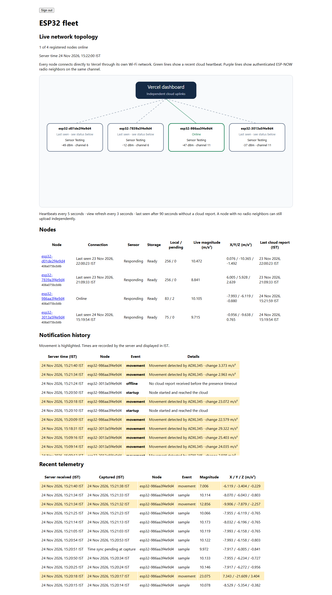

# Node esp32-986aa3f4e9d4

This third registered board was commissioned on November 23, 2026. COM5 was later reused by another physical board; identify it by Node ID and MAC, not the port number.

## November 26 calibration started

COM5 identity was reverified as this board on firmware `795d041`, revision `none`. The raw USB sampler recorded 120 component-up measurements at approximately **10:48:14–10:50:14 IST**, mean Z **8.151477 m/s²**, with low variation and no missed raw replies. One initial status read was incomplete; the bounded second read verified identity before measurements began. The sampler did not change settings or firmware. This is one fitting reference, not a completed calibration. The opposite face and X/Y pairs, independent validation and any installation remain outstanding; no Node 1/2 coefficients were copied. See [the calibration record](CALIBRATION.md#node-3-raw-reference-measurements--november-26).

The first opposite-face attempt stopped after 53 samples at a host response timeout and was retained/excluded. Fresh status/raw probes were healthy with unchanged cloud boot. A new full retry with an explicit five-second USB response deadline recorded 120 samples at approximately **10:56:52–10:58:52 IST**, mean Z **-11.358712 m/s²**, with no missed replies and identity correction unchanged. No calibration values were applied. The timeout cause remains undiagnosed; the retry's measured data are separate from the incomplete attempt. Remaining X/Y references and validation are still required.

X-up then recorded **119 valid raw samples** at approximately **11:02:09–11:04:09 IST**, mean X **+10.051607 m/s²**, with low variation and no missed replies. The actual count/span passed the unchanged minimum requirements; it was not rounded up to 120. No calibration settings changed. Three references are now recorded; X-down, both Y faces and independent validation remain outstanding.

X-down USB acquisition then stopped after 47 samples despite the five-second response deadline. That incomplete attempt is preserved and excluded. A separate cloud window at **11:09:05–11:11:05 IST** recorded **12 unique samples spanning 110 seconds**, mean X **-10.020438 m/s²**, with stable boot/firmware and revision `none`. Its uncorrected axes passed the existing cloud reference protocol; no partial USB data were merged. Four reference positions are now recorded. Both Y faces, fitting, independent validation and installation remain. See the [full reference record](CALIBRATION.md#node-3-x-down-usb-interruption-and-independent-cloud-reference).

Y-up cloud acquisition subsequently recorded **12 unique samples spanning 110 seconds**, captured **11:15:22–11:17:12 IST**, with mean Y **+9.899323 m/s²** and low variation. Node identity, boot, firmware and revision `none` stayed consistent. [Complete evidence](calibration/node3-y-up-cloud-2026-11-26.json) preserves source and capture/receipt times. Five fitting positions are recorded; Y-down, fitting, independent validation and installation remain. No settings were changed.

| Item | Verified value |
| --- | --- |
| Node ID | `esp32-986aa3f4e9d4` |
| Station MAC | `d4:e9:f4:a3:6a:98` |
| Chip | ESP32-D0WD-V3 revision 3.1 |
| USB port during commissioning | COM5 |
| Firmware | `408a075bcb8b8eb4366a380ffc283637349bcc57` |
| Sensor | ADXL345, address `0x53`, DEVID `0xE5` |
| Wiring | SDA GPIO21, SCL GPIO22, VCC 3V3, common GND |
| Sensor mode | Full resolution, ±16 g, 100 Hz |
| Saved SSID | Sensor Testing |
| Sample interval / sensitivity | 10 seconds / 1 |
| Movement threshold | 1.5 m/s² vector change |
| Touch input / threshold | GPIO4, threshold 30, four-second hold |
| Status output | GPIO2 |
| Setup SSID | `ESP32-Setup-986aa3f4e9d4` |
| API origin / endpoint | `https://esp32-fleet-iot-project3.vercel.app` / `/v1/telemetry` |
| OTA manifest | `https://esp32-fleet-iot-project3.vercel.app/v1/firmware` |

Wi-Fi/AP passwords, the individual API secret and discovery key remain private. Its API secret is distinct from the other nodes. SSID/password and other settings remain editable in its captive portal; see the [operating manual](OPERATING_MANUAL.md).

## Backup and installation

The original application did not answer the fleet status command. Its partition/settings/application region through `0x14ffff` was archived privately using smaller reads with retries. The 1,376,256-byte backup has SHA-256 `a4edb3d67376f0540348108472043be116ca0ece388ace61cc306419fd70a44e`. The original application checksum and validation hash passed. Backup files contain private settings and are excluded from Git.

The partition table matched two 1,310,720-byte application slots and the filesystem at `0x290000`. Both filesystem superblock pages were blank. A unique API credential was added to Production `NODE_SECRETS_JSON`, retaining the two existing entries. Redeployment `dpl_5jZ1VtFCbTuBrRCKqjCCZobpTdTf` reached Ready.

The public release binary was verified before flashing: 1,224,352 bytes, SHA-256 `98ac1d523cb4ef7c1d1bd43e0d99c17891815059c50a3254bea62eaced0bb6e1`. USB installation at 115200 baud wrote the matched bootloader at `0x1000`, boot-selection data at `0xe000`, application at `0x10000`, and the newly initialized LittleFS image at `0x290000`. The existing partition table and NVS were retained; provisioning subsequently saved the intended settings in NVS. All written image hashes verified. BOOT intervention was not required. Do not repeat filesystem initialization during routine updates.

## Recorded acceptance checks

- At 22:14:44 IST the node acknowledged permanent configuration and rebooted. It identified the correct sensor and loaded the existing first local record, demonstrating retention across the configuration reboot.
- Telemetry and heartbeat returned HTTP 200 under its own identity. Settings restored automatically; setup AP was inactive.
- At 22:15:54 serial reported the exact release, eight retained records, zero pending uploads, healthy sensor/storage, synchronized IST and setup inactive.
- At 22:15:56 the scheduled OTA check advertised the same version already running. No unnecessary image installation occurred.
- At 22:17:24 the read-only integrity check validated 17 records, zero invalid, in 607 ms.
- The operator tilted the device. Event `398d05f9e88ba442c6b896439b5db197`, captured at 22:19:44 IST, appeared in notification history at 22:19:46.023 IST with movement delta 21.13259 m/s². Other fresh movement alerts were also persisted.
- The authenticated dashboard API at 22:20:12 IST showed mode running, healthy sensor/storage, synchronized time, 39 retained records and zero pending uploads. All three registered identities and their separate histories were present.

On November 24 the dashboard showed Last seen at November 23, 22:23:54 IST, with last-reported values of 66 local records and one pending record. These are historical values, not a new live health check. The connected COM5 board was then identified as a different MAC, and the operator explicitly requested commissioning it too. No reflash or settings change was made to this third board during that follow-up.

Calibration, sustained-throughput tests, controlled power cuts, failed-image rollback and simultaneous multi-node radio testing remain separate acceptance work. See [verification](VERIFICATION.md) and [firmware behavior](FIRMWARE.md).

## November 24 reconnect check

The operator reconnected this board after commissioning the fourth board. Read-only MAC identification and serial status confirmed the same identity and the already-installed `408a075` release. No reflash, filesystem upload, configuration write, secret rotation or additional registration was performed.

At 15:21:01 IST serial reported saved Sensor Testing Wi-Fi, ADXL345 address 0x53, healthy storage, synchronized time, setup inactive, 75 retained records and zero pending uploads. Authenticated heartbeat and telemetry returned HTTP 200, confirming that its original individual credential remained valid after the fourth registration had been added.

Around 15:22 IST a read-only integrity check validated all 83 then-retained records with zero invalid records in 8,021 ms. The authenticated dashboard showed this board online in running mode, live readings, healthy sensor/storage and the four existing registrations. Its two pending readings at that dashboard snapshot were in the retry/upload queue; successful uploads continued. Newly observed movement records also appeared in cloud notification history without requesting another physical tilt test.

The saved Vercel OTA channel was checked at approximately 15:23 IST and advertised the exact version already running, so no image was reinstalled. The serial port was released after diagnosis. This verifies ordinary reconnect/restart persistence; it does not replace a controlled interruption-during-write test.

The screenshot is a dated checkpoint. Online status and pending counts continue to change with power, network access and new samples.
