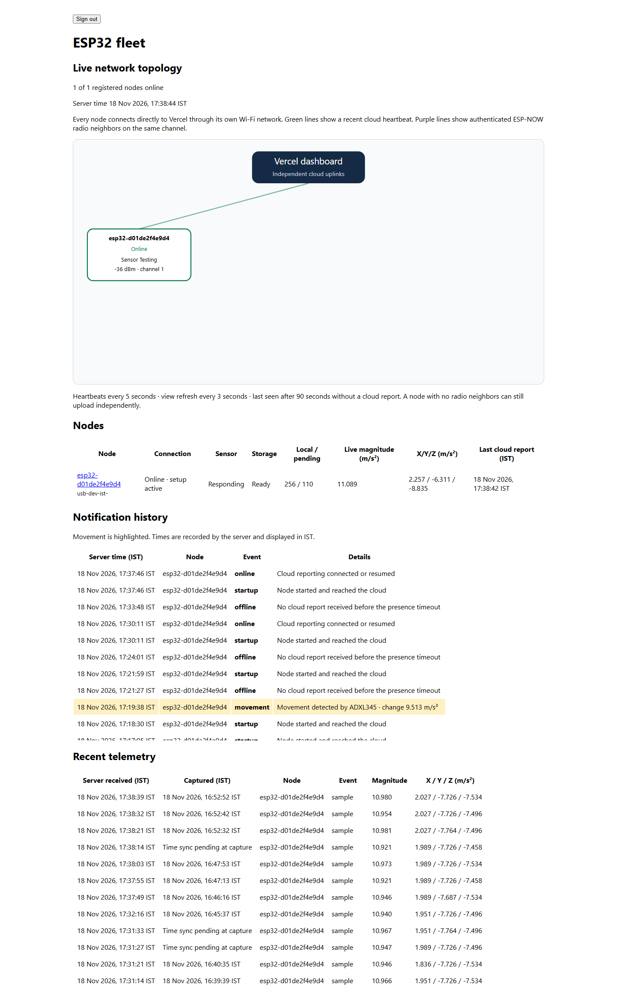

# Fleet operating, configuration, troubleshooting, and safety manual

This is the operating reference for the classic ESP32 Dev Module with an ADXL345 and the Vercel/Atlas application. Commands use PowerShell from the repository root. Keep passwords and API secrets in a password manager or ignored local files.

## 1. Known installation

| Item | Value |
| --- | --- |
| Repository | https://github.com/rohitlaikhuman8-ui/IOTProject |
| Dashboard | https://esp32-fleet-iot-project3.vercel.app/ |
| Connected node | `esp32-d01de2f4e9d4` |
| USB port | COM5, rediscover if Windows changes it |
| Sensor wiring | GPIO 21 → SDA, GPIO 22 → SCL, 3V3 → VCC, GND → GND |
| Sensor identity | ADXL345 at 0x53, device ID 0xE5 |
| Setup touch input | GPIO 4 / T0, using a capacitive pad |
| Status LED | GPIO 2, normally the controllable blue LED |
| Local portal | http://192.168.4.1/ while connected to setup Wi-Fi |
| Test SSID | Sensor Testing |
| Display timezone | Asia/Kolkata, IST, UTC+05:30 |

The red power LED only indicates supply power. The controllable status LED and the dashboard report different conditions. A Wi-Fi association alone does not confirm that the API, database, DNS, or internet connection works.

## 2. Daily power-on procedure

1. Connect the known stable USB supply.
2. Allow the saved Wi-Fi connection to associate and obtain DHCP.
3. Local acquisition and logging begin as soon as the sensor and filesystem are ready.
4. The node attempts authenticated uploads as soon as Wi-Fi is connected.
5. It starts SNTP and also synchronizes its clock from authenticated server responses on every boot.
6. The cloud records its own receive timestamps and creates a startup notification.
7. Open the dashboard and sign in. The node should show Online after a recent accepted heartbeat or telemetry report.
8. Check Sensor, Storage, Pending records, signal strength, and current acceleration.

Existing credentials are reused automatically. A new node, or a configured node whose Wi-Fi remains unavailable after about 30 seconds, opens its setup AP. It continues attempting the saved network connection.

The status task runs independently of telemetry uploads and OTA downloads. Heartbeats are scheduled every five seconds. The browser refreshes every three seconds. After 90 seconds without an accepted cloud report, it shows Last seen with the last server timestamp in IST. If the browser itself loses contact, the page indicates stale or unavailable status.



## 3. LED interpretation

| Pattern | Meaning | First action |
| --- | --- | --- |
| Solid on | Recent successful cloud report | Check live values and notification history |
| Slow blink, roughly 0.5 second on/off | Wi-Fi reconnecting | Check SSID, password, signal and router |
| Two short flashes every two seconds | Wi-Fi associated, cloud report pending or expired | Check internet, DNS, API URL and node credentials |
| Fast blink | Setup AP active | Join the AP and open the portal |
| Three short flashes every two seconds | Sensor or local storage needs attention | Read serial diagnostics and inspect wiring/storage |

Setup indication takes priority while the AP is active. GPIO 2 and active-high behavior match the typical DevKit LED. Verify your exact board if the programmable LED is wired differently or absent. A software output-state check does not replace visual verification.

## 4. Open and use the captive portal

1. Keep the ESP32 powered.
2. Hold the GPIO 4 capacitive pad continuously for four seconds. The mechanical BOOT button is a different input.
3. Observe the fast status blink.
4. Join `ESP32-Setup-f4e9d4` for the known node. Other nodes use their own ID suffix.
5. Use that node's private setup AP password. It is generated and saved at first setup and printed on USB serial when the AP opens.
6. Stay on the setup Wi-Fi even if the phone warns that it has no internet.
7. Open a browser at `http://192.168.4.1/` if no captive popup appears.
8. Review identity, settings, cloud connection status, current IST time and pending record count.
9. Review the latest local logs on the page or download the complete retained log.
10. Save any settings change and wait for restart.
11. Reconnect the phone/computer to its usual network and confirm the node reports again.

The AP allows one client and expires after 15 minutes. Its current station connection remains active when the router is available, so entering setup does not deliberately stop cloud reporting. Configuration and logs are accepted only through the setup-AP interface. They are rejected through the station IP.

If there is no touch pad, open USB Serial Monitor at 115200 baud with newline endings and send `portal`. On a first boot with no saved SSID, setup starts automatically.

## 5. Configuration field reference

| Setting | Meaning and limit |
| --- | --- |
| SSID | Exact network name, 1–32 characters |
| Wi-Fi password | 8–64 characters, blank retains the old password for the same SSID |
| Use open Wi-Fi | Explicitly clears the Wi-Fi password for an open network |
| Setup AP password | 8–63 characters when changed, blank keeps the saved value |
| Backend base URL | HTTPS origin, for example `https://esp32-fleet-iot-project3.vercel.app` |
| Ingest endpoint | `/v1/telemetry` for the supplied application |
| Node API secret | Unique per node, 24–128 characters, use at least 32 random characters |
| Fleet discovery key | Shared only by a discovery group, 32–128 characters, blank retains it |
| OTA manifest URL | HTTPS release manifest, empty disables automatic checks |
| Sensitivity | Summary-magnitude multiplier, 0.01–100 |
| Touch threshold | Touch activates below this value, 1–65,535 |
| Movement threshold | Acceleration-vector change in m/s², 0.2–100, default 1.5 |
| Sample interval | Periodic sample spacing, 10–86,400 seconds |

The movement threshold is separate from touch threshold and sensitivity. Small movements below the configured threshold are not classified as movement. Samples and movement events can still be delayed by physical sensor and flash constraints.

## 6. Change SSID

1. Open the node's portal.
2. Enter the new SSID exactly, including spaces and capitalization.
3. Enter the new network's password, even if you previously used a different network.
4. Keep the existing backend and API settings.
5. Save and let the node restart.
6. Confirm Online, the new reported SSID, signal strength, and a fresh server timestamp.

If association fails, reopen setup using the same saved AP password. The node also opens recovery setup after a sustained Wi-Fi failure. Restore the old SSID/password or correct the new values.

## 7. Change the Wi-Fi password only

1. Keep the SSID unchanged.
2. Enter the replacement password in the Wi-Fi password field.
3. Save and restart.
4. Confirm a new cloud report.

Blank means keep the existing password for that SSID. To intentionally use an open network, select its explicit checkbox. A password change on the router must also be applied to the node.

## 8. Change the setup AP password

1. Open the portal using the current AP password.
2. Enter a new 8–63-character value in Setup AP password.
3. Save it privately before submitting.
4. Save settings and restart.
5. Reopen setup and join using the new password to verify it.

If forgotten, an authorized operator with USB access can open setup and read its printed password locally. If setup is already active and `portal` prints nothing, restart the node with Serial Monitor open, then send `portal` to open a new session and print the saved password. Keep serial transcripts containing credentials out of shared logs. Deliberate full-chip erasure is a last resort because it removes settings and local records.

## 9. Change backend or endpoint

1. Confirm the replacement API implements the documented schema and per-node authentication.
2. Register the node secret on that server first.
3. Verify a certificate-valid HTTPS origin accessible from the node's network.
4. Set the base origin and the ingest path in the portal.
5. Save, restart, and confirm accepted uploads on the new server.

The supplied firmware uses `/v1/heartbeat` at the same origin for presence and time synchronization. A replacement server must provide that route and an accurate standard HTTP `Date` response header. The supplied API additionally returns `serverTime` in epoch milliseconds for clients. Keep the previous settings in a private recovery record until the migration succeeds.

If the endpoint redirects, returns HTML, or requires an interactive hosting login, correct its production routing/protection settings. The ingest endpoint expects the final canonical URL.

## 10. Create and add a new node

1. Prepare a supported ESP32 and safely connect the sensor.
2. Build and upload the application.
3. Initialize LittleFS once on the new board.
4. Read its immutable hardware-derived Node ID from serial.
5. Generate an individual random API secret.
6. Add its entry to Vercel Production `NODE_SECRETS_JSON` without replacing other entries.
7. Redeploy the application so the new environment value takes effect.
8. Provision Wi-Fi, API origin/path, that secret, the optional discovery key, and OTA URL through its portal.
9. Confirm sensor/storage health, startup notification, current data, and IST server timestamps.
10. Record the board, site, Node ID, sensor, firmware, thresholds and owner in a private inventory.

```powershell
node -e "console.log(require('node:crypto').randomBytes(32).toString('hex'))"
```

Store the generated value privately. Use the exact lowercase Node ID. A replacement board receives a different ID. Do not copy the old board's identity or share its individual API secret.

## 11. Rotate a node API secret

1. Generate and privately store a new secret.
2. Keep the portal open on the node.
3. Update only its Production node-map entry in Vercel, preserving every other node.
4. Redeploy and wait for Ready.
5. Enter the new secret in the node portal, save and restart.
6. Confirm accepted heartbeats, backlog delivery and Online state.

The old value fails authentication after the new deployment. A brief mismatch leaves events queued. If delivery remains 401, confirm the exact node entry, deployed environment and saved node value. Blank in the portal keeps its previous secret.

## 12. Change the discovery group key

1. Generate a shared random discovery key of at least 32 characters.
2. Provision it on the intended group of nodes.
3. Save and restart each node.
4. Verify same-channel neighbor sightings after the next discovery and heartbeat cycles.

Individual API secrets stay unique. A discovery-key change can temporarily remove radio edges until both peers are updated. Every node's direct cloud uplink continues independently. Current radio discovery requires a common Wi-Fi channel and supports up to 16 neighbor sightings. Multi-hop event forwarding is not implemented.

## 13. Change movement and sampling settings

1. Place the mounted sensor in its normal idle position.
2. Review stationary readings and noise.
3. Choose a movement threshold above normal noise but below the movement of interest.
4. Set the sample interval and sensitivity independently.
5. Save and restart.
6. Allow the two-second movement baseline warm-up.
7. Gently tilt or move the board and check for a highlighted movement notification and local log entry.

The algorithm reads the sensor about every 20 ms outside flash work, compares acceleration with a slowly adapting baseline, and groups qualifying motion with a two-second cooldown. Continuous movement can produce successive events. This is an event detector, not a guarantee of every possible vibration or a calibrated safety instrument.

Changing the sampling interval affects periodic storage, while movement events are recorded between periodic samples. Sensitivity scales the summary value. Proper per-axis calibration still requires reference measurements.

## 14. Change touch threshold

Measure released and touched `touchRaw` values using `status`. Choose a threshold between those groups, save and test a four-second hold. A permanently low/floating/noisy input can repeatedly open setup.

If the threshold prevents touch access, use the USB `portal` command. Avoid external voltage on the touch input.

## 15. Change dashboard password

1. Set a distinct long random `DASHBOARD_PASSWORD` in Vercel Production.
2. Redeploy.
3. Store the new password privately.
4. Update the operator's ignored local copy if used by screenshot tools.
5. Sign in again and verify the live page.

The password also signs the eight-hour session cookie. A new deployment with a changed password invalidates old sessions. Node API secrets and Wi-Fi credentials are separate settings.

## 16. Remove, retire or replace a node

For temporary maintenance, record its ID, export logs, power it down, and keep its API registration. It remains in the dashboard with a Last seen timestamp.

For permanent retirement:

1. Export readable local data and back up its Atlas records if needed.
2. Remove only its entry from Production `NODE_SECRETS_JSON`.
3. Redeploy and verify future requests from that old secret are rejected.
4. Update the private inventory to retired.
5. Power down and safely decommission the device.

The active dashboard registry follows the node map. Removing a key removes it from that active list. Atlas historical events and notifications remain stored until an authorized operator deliberately deletes them. Query/export Atlas when reviewing records for a retired ID.

For a replacement board, add its new hardware ID with a new secret, commission it, and retire the old entry. Keep both historical identities in the inventory.

## 17. Data, movement notifications and time

The server supplies authoritative receive times. Atlas stores UTC date instants, and the dashboard formats them using Asia/Kolkata. The node also sets its local timezone to IST and synchronizes its clock on every boot through SNTP and authenticated server replies.

The dashboard distinguishes server receipt from optional device capture time. Offline records can arrive later, so a notification's server time describes receipt. Its record also retains capture time when known. Device clock uncertainty does not determine the dashboard's Last seen value.

Notification history includes startup, cloud connection/resumption, movement, and report-timeout events. Movement is highlighted. Offline notifications are recorded when the monitoring endpoint observes an expired server timestamp or a later heartbeat discovers an expired previous report. The timestamp marks the expiry, although the history entry can be written later. This free-tier setup has no always-running outage monitor.

The latest 100 notifications and 100 telemetry events are displayed. Older history remains in Atlas. Notifications are in-app records. External push, email and SMS delivery are not configured.

## 18. View and export local logs

In the portal, status and the latest 30 committed records refresh every three seconds. Download local log exports all retained pending and acknowledged records as NDJSON.

The full download first creates a temporary snapshot on flash, then streams it to the client. If export returns 503 for insufficient space, the committed records remain intact. Avoid repeated parallel downloads and keep the client connected until completion. A power-cut temporary snapshot is ignored as telemetry and overwritten on the next export.

Snapshot preparation can take time on a full filesystem. Cloud status runs independently, but the main-loop sensor acquisition can pause during this manual operation. Export during maintenance when uninterrupted acquisition is not required. A dedicated acquisition task and storage design would be needed for strict continuous-capture guarantees.

```powershell
Invoke-WebRequest http://192.168.4.1/log -OutFile .\esp32-log.ndjson
$records = Get-Content .\esp32-log.ndjson | ForEach-Object { $_ | ConvertFrom-Json }
$records | Sort-Object sampledAt,uptimeMs | Select-Object nodeId,kind,eventId,sampledAt,value
```

The device retains at most 256 committed records. Acknowledged records are reclaimed first. When every slot is unsent, new records cannot be retained until delivery creates reclaimable space. Movement increases storage consumption. The dashboard shows total and pending counts.

New movement records take priority over ordinary queued samples. Periodic backlog delivery continues afterward. A RAM filename index is rebuilt from LittleFS at boot and updated only after successful file changes, avoiding repeated flash-directory walks during heartbeats.

Download/export before formatting, replacing the partition table, deliberate erasure or physical retirement.

## 19. Firmware builds and USB upload

Install Git and Python 3.12. From the repository root:

```powershell
py -3.12 -m venv .venv
.\.venv\Scripts\python.exe -m pip install platformio==6.1.18
.\.venv\Scripts\python.exe -m platformio device list
.\.venv\Scripts\python.exe -m platformio run -d firmware
.\.venv\Scripts\python.exe -m platformio run -d firmware -t upload --upload-port COM5
```

On a new board only, initialize the filesystem:

```powershell
.\.venv\Scripts\python.exe -m platformio run -d firmware -t uploadfs --upload-port COM5
```

Close Serial Monitor before uploading. If the uploader stays at Connecting, hold BOOT until writing begins, then release it. A normal update keeps the partition layout unchanged and uploads the application.

For Arduino IDE export, run `powershell -ExecutionPolicy Bypass -File scripts/export-arduino.ps1`. Use the documented Espressif core 2.0.17, ArduinoJson 7.3.1, ESP32 Dev Module and COM5. The filesystem still needs explicit initial provisioning.

## 20. OTA procedure and recovery

Firmware changes pushed to main trigger GitHub Actions, which builds a commit-specific image and updates the stable manifest. Configure its URL on each node that should follow that channel.

```text
https://github.com/rohitlaikhuman8-ui/IOTProject/releases/download/firmware-latest/manifest.json
```

Before a fleet release, test a bench node, preserve logs, check slot size, and coordinate the update window. Nodes follow the configured channel when connected. A failed check retries later.

The image is checked for board, length and SHA-256 over verified HTTPS. A pending image must reach healthy storage, sensor, time and cloud reporting before accepting boot. For a confirmed faulty image, publish a corrected new commit or a new commit reverting it. For an unreachable board, use USB application recovery and retain the filesystem where possible.

Changing partition layouts, bootloaders, Secure Boot or flash encryption requires a separately planned migration.

## 21. Serial diagnosis

Open Serial Monitor at 115200 baud with newline endings.

| Command | Purpose |
| --- | --- |
| status | Identity, version, Wi-Fi, cloud age, local IST time, pending records, memory and LED state |
| sensor | Current X/Y/Z and magnitude |
| sample | Commit a manual sensor sample |
| portal | Open setup without touching GPIO 4 |

The repository's `scripts/serial-check.py` supports explicit reset and private JSON commissioning. Its configuration helper opens setup, paces commands and requires acknowledgment. Cloud reporting continues on the current firmware. Keep its private configuration file out of Git. Opening serial for observation should not intentionally reset the board.

## 22. Troubleshooting matrix

| Symptom | Checks and recovery |
| --- | --- |
| No power LED | Check USB supply, cable and board connector |
| Power present but no serial | Check COM port, data-capable cable, driver and baud |
| COM port busy | Close Arduino Serial Monitor and other serial clients |
| Upload cannot connect | Confirm COM5, use BOOT/EN sequence, inspect cable and USB power |
| Upload stops midway | Keep power stable, close competing serial clients, retry at 115200 baud, inspect cable/USB connector if repeated |
| Build dependency download fails | Check internet/proxy, rerun the pinned tool installation |
| New firmware too large | Inspect build output and reduce features or plan a partition migration |
| Setup AP absent | Read serial, use portal command, verify touch pin and threshold |
| Setup opens repeatedly | Check touch input noise, threshold, mounting and wiring |
| Cannot join AP | Verify saved AP password and single-client limit |
| Phone says no internet | Stay connected and open the explicit HTTP portal URL |
| Captive popup absent | Type http://192.168.4.1/ directly, avoid HTTPS |
| Portal returns 403 | Join the setup AP, reopen the page for a fresh form token |
| Portal save returns 400 | Check field lengths, HTTPS origin/path and numeric ranges |
| Portal save returns 500 | Check NVS persistence, capture diagnostics, retry before assuming settings changed |
| Portal logs return 503 | Let an OTA or busy request finish, retry, and check memory diagnostics; history remains on flash |
| Wrong SSID/password | Reopen setup and correct both values |
| Router password changed | Save the new password on every affected node |
| Wi-Fi good but no cloud | Check WAN/DNS, endpoint, API secret, hosting protection and LED cloud-pending pattern |
| Dashboard says Last seen | Compare last accepted server time, current serial cloud age, retries, browser connectivity and LED |
| Browser status stale | Reload, check its internet, sign in again, inspect API errors |
| Ingest returns 401 | Verify exact Node ID, registered secret, deployed environment and saved node value |
| Ingest returns 400 | Compare payload with API schema |
| Ingest returns 413 | Check UTF-8 body length and Content-Length |
| API returns 503 | Check Atlas URI, user role, network access, cluster availability and Vercel logs |
| Vercel login page before API | Review production Deployment Protection |
| Time sync pending | Check SNTP reachability and accepted authenticated server replies |
| IST appears offset twice | Use UTC epoch values and one Asia/Kolkata formatting step |
| Receive time newer than capture | Offline backlog or network delay, inspect both fields |
| No movement notification | Check sensor health, threshold, warm-up, cooldown, retained queue and cloud delivery |
| Movement alerts at rest | Measure noise, inspect mounting, raise threshold and check power |
| Values differ from gravity | Perform multi-orientation calibration and a reference check |
| Sensor not found | Recheck 3V3/GND/SDA/SCL, CS high and SDO address strap |
| Flat or implausible values | Check sensor identity, loose wires, range and mechanical mounting |
| Local log full | Restore cloud delivery, export retained records, assess retention requirements |
| LittleFS cannot mount | Preserve recoverable data, check supply, initialize only a new/approved replacement filesystem |
| Repeated resets/brownouts | Use a stable supply, inspect cable/load and review reset reason |
| Watchdog or stack panic | Save serial trace and firmware SHA, use a known-good release and diagnose resource use |
| OTA deferred | Check connectivity, manifest, signed redirects, size/hash, certificate trust and free OTA slot |
| OTA version stays old | Confirm channel URL, successful Actions release, polling, accepted boot and failed-version suppression |
| No radio edges | Check shared discovery key, physical range and common Wi-Fi channel |
| Isolated radio node | Confirm its independent Wi-Fi uplink; no neighbor is required for cloud reporting |
| Retired node still sends | Remove its key from the correct production map and redeploy |
| Added node rejected | Preserve other map entries, confirm exact new ID/secret and redeployment |
| Dashboard Git auto-deploy absent | Complete Vercel GitHub Login Connection and link the existing project |

When escalation is needed, record Node ID, firmware SHA, exact time in IST, server response code, LED pattern, reset reason and redacted serial output. Exclude Wi-Fi passwords, API secrets, discovery keys and database credentials.

## 23. Backup and restore

Back up Atlas using its available export/backup facilities and export device NDJSON before destructive recovery. Store private configuration and inventory separately from public source.

Reflashing the application with an unchanged layout preserves NVS and LittleFS. Uploading the filesystem replaces local history. Full-chip erasure removes both settings and records. After an authorized full reset, repeat registration/provisioning and check that the original hardware Node ID matches the inventory.

Restore database records into a development environment first when investigating schema or backup problems.

## 24. Safety and deployment practice

1. Disconnect power before changing wiring.
2. Use 3.3 V-compatible sensor and GPIO connections.
3. Prevent shorts between 3V3, GND and adjacent pins.
4. Avoid back-feeding USB from a second supply without a designed power arrangement.
5. Use a stable supply and data-capable cable.
6. Apply basic ESD precautions and mount the board to avoid conductive contact.
7. Keep the touch pad away from externally powered conductors.
8. Export logs before destructive storage operations.
9. Avoid unplugging during deliberate flashing or OTA. Recovery mechanisms reduce risk but cannot preserve an uncommitted sample.
10. Test threshold, calibration, power interruption and recovery on a bench before relying on deployed measurements.
11. Store credentials privately and rotate them when a device or operator access is retired.
12. Verify the exact target repository, branch, board and port before publishing or flashing.

The current system is a telemetry prototype undergoing hardware validation. Sensor calibration, multi-node RF testing, workload/retention planning, independent backup and operational monitoring remain deployment responsibilities.

## 25. Change records

For every change, record the affected node IDs, previous firmware/configuration reference, new version or nonsecret settings, reason, operator, verification result, rollback action and IST time. Update this manual and the relevant guides alongside implementation changes. Never place secret values in a public change record.
