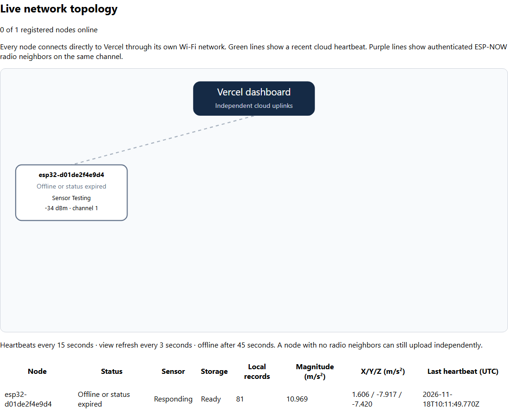

# Live topology and independent uplinks

Each node establishes its own Wi-Fi connection and sends authenticated HTTPS data directly to Vercel. It can continue reporting when no other ESP32 is nearby, as long as its configured Wi-Fi network provides internet access.

## Live status

- Nodes send an authenticated heartbeat every 15 seconds.
- The signed-in dashboard fetches status every 3 seconds.
- Last heartbeat older than 45 seconds marks a node offline.
- After 15 seconds without fresh dashboard data, the view marks the snapshot stale.
- The client retries failed fetches with backoff and cleans up timers and requests when leaving the page.
- Hardware status reports current sensor response, filesystem availability, retained record count, Wi-Fi RSSI, channel, and firmware version.
- The live table shows the most recently received acceleration and magnitude.

This is near-real-time polling. End-to-end delay includes the heartbeat interval, dashboard polling, and network latency.

The current synchronous OTA transfer pauses ordinary heartbeat work while an image downloads. A long transfer may temporarily appear offline until the new image reconnects. Treat update-time gaps separately when reviewing availability.

## Radio links

The firmware sends ESP-NOW discovery beacons every approximately five seconds on its current station Wi-Fi channel. Beacons contain the source MAC, timestamp, protocol magic, and HMAC-SHA256 using a shared fleet discovery key.

Nodes validate the packet length, source MAC, group HMAC, and timestamp before updating a neighbor sighting. Sightings expire after 45 seconds. Up to 16 neighbors are retained and the backend filters them to registered node IDs.

Configure the same random discovery key on nodes that should discover one another. This key is separate from their unique API secrets. It is configurable in each node's portal and retained when its field is left blank.

The graph shows:

| Visual | Meaning |
| --- | --- |
| Green cloud line | Recent independently authenticated cloud heartbeat |
| Amber node | Online but sensor or storage needs attention |
| Grey dashed cloud line | No recent heartbeat or stale dashboard data |
| Solid purple neighbor line | Both online nodes recently reported hearing each other |
| Dashed purple neighbor line | Only one online node reported the other |

A radio line is an observed neighbor relationship. This implementation does not forward sensor events between nodes or provide multi-hop mesh routing. ESP-NOW discovery requires a shared radio channel, so nodes on different Wi-Fi channels may both upload directly while showing no neighbor line. Only one physical node is currently available for validation.

## Routes and records

`POST /v1/heartbeat` uses the same per-node bearer secret as telemetry. The payload contains nodeId, uptimeMs, version, ssid, rssi, channel, storageReady, sensorReady, logRecords, and neighbors. Maximum Content-Length is 2048 bytes.

`GET /api/topology` requires the signed dashboard session. It returns registered nodes and their latest state from the Atlas `nodes` collection. Nodes that have never sent a heartbeat appear as awaiting their first report. Values and neighbor IDs come from authenticated device reports.

## Deployment readiness

Validate two or more physical nodes on a shared channel before relying on neighbor edges. Validate independent uplinks on different networks, router loss, RF separation, and eventual recovery. Finite local retention, sensor calibration, free-tier quotas, and operator authentication controls must match the deployment's requirements.

A healthy online dot proves a recent heartbeat. It cannot by itself prove measurement calibration, complete RF coverage, or long-term availability.

The first node's offline timeout was exercised by placing it in setup AP mode. Local samples continued and the dashboard correctly marked its expired heartbeat offline.

